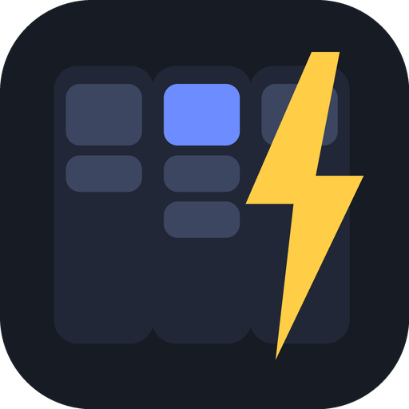

<div align="center">



# Project Manager

**A fast, local-first project and task manager with Trello-style boards, a calendar, timelines and a personal dashboard.**

[](https://github.com/Sabinaya-Sapkota/project-manager/releases/latest)
[](https://github.com/Sabinaya-Sapkota/project-manager/actions/workflows/ci.yml)
[](LICENSE)
[](https://tauri.app)

[**Try the live demo**](https://project-manager.sabinayasapkota.info.np/) · [**Download for Windows**](https://github.com/Sabinaya-Sapkota/project-manager/releases/latest) · [Report a bug](https://github.com/Sabinaya-Sapkota/project-manager/issues/new/choose)

</div>

---

## Why Project Manager?

Most boards apps want an account, a subscription and an internet connection. Project Manager keeps everything on your own machine in a single SQLite database. It opens instantly, works offline, and gives you the flexibility of Trello with the extras you actually reach for: a calendar, a timeline, milestones, recurring tasks, dependencies and a dashboard you can rearrange.

- **Local-first and private.** No account, no telemetry, no cloud. Your data is a file you own.
- **Flexible, not rigid.** Workspaces, boards and lists have no fixed statuses. Build whatever workflow suits you.
- **Light on resources.** A native Rust backend with a small web UI, packaged with [Tauri](https://tauri.app).
- **Easy to take with you.** Export everything as JSON, back up automatically, or sync through any folder your cloud drive already syncs.

## Try it in your browser

The [web demo](https://project-manager.sabinayasapkota.info.np/) runs the exact same interface entirely in your browser, with sample data. Nothing is uploaded, and your changes are kept in the browser's local storage. You can even install it from your browser's address bar as an app that works offline.

The demo leaves out the features that need the desktop: folder sync, native notifications, opening the data folder and large attachments (demo files are limited to 1 MB).

## Features

### Organise your work
| | |
|---|---|
| **Workspaces and boards** | Unlimited workspaces with custom names, icons and colours. Boards have their own background colour and can be duplicated, starred as favourites and exported to Markdown. |
| **Lists** | Add, rename, recolour, reorder by dragging, archive done cards or all cards in one click. |
| **Cards** | Drag cards between lists, with a description, priority, start and due dates, labels, checklists, attachments, comments, custom fields and a full activity history. |
| **Templates** | Save any card as a reusable template and create new cards from it. |

### Plan your time
- **Calendar** with cards and milestones on their due dates
- **Timeline** with bars from start date to due date and milestone flags
- **Milestones** per board, shown on the calendar and dashboard
- **Recurring cards** (daily, weekly, monthly) that reschedule themselves when completed
- **Dependencies** that keep a card locked until what it depends on is done
- **Time tracking** with estimates, a per-card timer and a focus (Pomodoro) timer

### Stay on top of everything
- **Home dashboard** you can reorder and toggle: overdue, due today, upcoming, milestones, project progress, favourite and recent boards, recently updated cards, quick-capture inbox, notes and a focus timer
- **Global search** and per-board filters and sorting, with **saved filters**
- **Right-click menus** on cards, lists, boards, workspaces and inbox items
- **Archived cards** screen with restore
- **Desktop notifications** with a daily summary of what is overdue or due today
- **Keyboard shortcuts**: `/` search, `h` home, `c` calendar, `n` new card

### Your data, your rules
- **Backups** are made automatically at launch, with manual backups and a restore screen
- **Export and import** the whole database as JSON
- **Folder sync** through OneDrive, Dropbox, Google Drive, Syncthing or any synced folder
- **Dark and light themes** with a custom accent colour
- **Starter workspaces** for software, security, web, content creation, game development, creative projects, education and personal life

## Install

### Windows
1. Download the latest `Project Manager_x.y.z_x64-setup.exe` from the [Releases page](https://github.com/Sabinaya-Sapkota/project-manager/releases/latest).
2. Run it. The installer works per user, so it does not need administrator rights.

> **Note:** the installer is not code-signed yet, so Windows SmartScreen may warn you. Choose **More info**, then **Run anyway**.

### macOS and Linux
Prebuilt installers are not published yet. You can [build from source](#build-from-source), as Tauri supports both platforms.

## Where is my data?

Everything lives in your user data folder, in a directory named after the app identifier `dev.crazyboyjack.commandcentre`:

| Platform | Location |
|---|---|
| Windows | `%APPDATA%\dev.crazyboyjack.commandcentre\` |
| macOS | `~/Library/Application Support/dev.crazyboyjack.commandcentre/` |
| Linux | `~/.local/share/dev.crazyboyjack.commandcentre/` |

It contains `data.db` (your database), `attachments/`, `backups/` and `exports/`. **Settings, then Data, then Open data folder** takes you there.

## Sync between devices

1. Pick a folder that your cloud drive already keeps in sync on every device.
2. On each device open **Settings, then Data, then Sync**, paste that folder's path and press **Sync now**.

The app writes one file, `command-centre-sync.json`, plus an `attachments/` folder there. It checks for changes at launch and every five minutes. If only one device changed, it pushes or pulls automatically. If both changed, you choose which side wins, and a backup is created before any pull.

Sync works on the whole database, not card by card, so avoid editing on two devices at the same time between syncs.

## Build from source

You need [Rust](https://rustup.rs) and the [Tauri prerequisites](https://tauri.app/start/prerequisites/) for your operating system (on Windows: the Visual Studio C++ Build Tools).

```bash
git clone https://github.com/Sabinaya-Sapkota/project-manager.git
cd project-manager
cargo install tauri-cli --version "^2" --locked

cargo tauri dev      # run with live reload
cargo tauri build    # produce the installer
```

On Windows you can also double-click `build-installer.bat`. It builds the app and copies the setup file into an `installer` folder.

### Run the web demo locally

```bash
mkdir site
cp -r ui/* demo/* site/ && cp src-tauri/src/schema.sql site/
cd site && python -m http.server 8080
```

Then open <http://localhost:8080>.

## Tech stack

| Layer | Technology |
|---|---|
| Desktop shell | [Tauri 2](https://tauri.app) |
| Backend | Rust, [rusqlite](https://github.com/rusqlite/rusqlite) (bundled SQLite) |
| Frontend | Plain HTML, CSS and JavaScript with no build step |
| Web demo | [sql.js](https://github.com/sql-js/sql.js) (SQLite compiled to WebAssembly) behind the same command interface |

## Project structure

```
project-manager/
├── src-tauri/          Rust backend and Tauri configuration
│   └── src/
│       ├── main.rs     Commands, sync, backups, notifications
│       └── schema.sql  Database schema
├── ui/                 The interface, shared by the app and the demo
├── demo/               Browser backend and web-app files for the demo site
├── assets/             Icons and images
└── .github/workflows/  CI, release builds and demo deployment
```

## Publishing your own copy

1. Push the repository to GitHub.
2. In **Settings, then Pages, then Build and deployment**, set the source to **GitHub Actions** (not "Deploy from a branch", which would show this README instead of the demo). The demo deploys on every push to `main`, or run **Deploy web demo** manually from the Actions tab.
3. Tag a release, for example `git tag v0.1.0 && git push --tags`. The release workflow builds the Windows installer and attaches it to a new GitHub release.

### No workflows? Use the pre-built copy

The `docs/` folder contains the demo site already assembled. If you prefer not to use Actions, go to **Settings, then Pages**, choose **Deploy from a branch**, pick `main` and the **`/docs`** folder, and save. After changing `ui/` or `demo/`, rebuild it with:

```bash
rm -rf docs && mkdir docs && cp -r ui/* demo/* docs/ && cp src-tauri/src/schema.sql docs/ && touch docs/.nojekyll
```

## Roadmap

- Installers for macOS and Linux
- Row-level sync that merges changes instead of choosing a side
- Code-signed Windows builds
- Per-card reminders
- Gantt-style dependency arrows on the timeline

Ideas and feedback are welcome in the [issue tracker](https://github.com/Sabinaya-Sapkota/project-manager/issues).

## Contributing

Contributions are welcome. Please read [CONTRIBUTING.md](CONTRIBUTING.md) first, and see [SECURITY.md](SECURITY.md) for how to report a vulnerability privately.

## License

Released under the [MIT License](LICENSE). The web demo bundles [sql.js](https://github.com/sql-js/sql.js), which is also MIT licensed (see `demo/vendor/LICENSE-sqljs.txt`).
